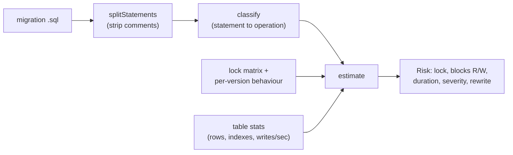

# locksmith

A migration linter that predicts which PostgreSQL lock a DDL statement takes, whether it blocks reads or writes on your target server version, and roughly how long it will hold that lock on a table of a given size.

[](https://github.com/SlateGitOrg/locksmith/actions/workflows/ci.yml)

## Why

A one-line migration adds a column with a default and takes an `ACCESS EXCLUSIVE` lock. On a 400-million-row table running PostgreSQL 10, that stalls every write for the better part of an hour, and the team finds out during the deploy, when rolling back is also expensive. Generic linters pattern-match keywords and give version-blind advice, which is simply wrong for PostgreSQL 11+, where several of these operations stopped being blocking. locksmith evaluates each statement against the lock behaviour of the server version you target, so the warning says "this blocks writes on `orders` for about 3 minutes", not "this statement takes a lock".

## Features

- Splits a migration file into statements, ignoring comments, and classifies each into one of 18 operation kinds (add column with or without default, `SET NOT NULL`, `CREATE INDEX [CONCURRENTLY]`, foreign keys, `CHECK ... NOT VALID`, type changes, `CLUSTER`, `VACUUM FULL`, and so on).
- Encodes the PostgreSQL table-level lock conflict matrix (all eight modes) as data, and derives "blocks reads" and "blocks writes" from it.
- Version-aware behaviour for PG 10, 11 and 12+, recorded as changes only. Unlisted versions inherit the nearest lower entry.
- Estimates blocking time from row count and index count, and the number of writes that queue behind the lock from the observed write rate.
- Rates each statement `SAFE`, `CAUTION` or `DANGER`, and suggests a safe rewrite (add nullable then backfill in batches, `NOT VALID` then `VALIDATE`, `CONCURRENTLY`, dual-write column swap).
- Treats unrecognised statements as worst case, never as safe.
- Detects explicit `BEGIN ... COMMIT` migrations, where every lock is held until commit.

## Architecture



`src/parse.ts` turns SQL text into `{ operation, table, inTransaction }` records. `src/locks.ts` holds the conflict matrix, the per-version behaviour table and the estimator. Table statistics are passed in as plain objects; `src/demo.ts` supplies them inline.

## Quick start

Prerequisites: Node.js 22.18 or newer (24 recommended). TypeScript is executed directly through Node's type stripping, so there is no build step and no dependencies to install.

```bash
git clone https://github.com/SlateGitOrg/locksmith.git
cd locksmith
npm test        # 41 tests
npm run demo    # the same migration reviewed against PG 10 and PG 16
```

## Example

`npm run demo` reviews four statements against a 400M-row `orders` table with 4 indexes and 1,200 writes/sec. Trimmed output:

```text
  PostgreSQL 10
  !! ADD_COLUMN_DEFAULT            ACCESS EXCLUSIVE         50.0min  DANGER
       blocks writes; ~3,600,000 writes queue behind it
       rewrites the entire table (fixed in PG 11)
       rewrite: add the column nullable, backfill in batches, then SET DEFAULT
  !! SET_NOT_NULL                  ACCESS EXCLUSIVE          3.3min  DANGER
  !! CREATE_INDEX                  SHARE                     3.3min  DANGER
     ADD_CHECK_NOT_VALID           ACCESS EXCLUSIVE             5ms  SAFE
     total write-blocking time: 56.7min

  PostgreSQL 16
     ADD_COLUMN_DEFAULT            ACCESS EXCLUSIVE             5ms  SAFE
  !! SET_NOT_NULL                  ACCESS EXCLUSIVE          3.3min  DANGER
       PG 12+ can skip the scan if a matching validated CHECK exists
  !! CREATE_INDEX                  SHARE                     3.3min  DANGER
     ADD_CHECK_NOT_VALID           ACCESS EXCLUSIVE             5ms  SAFE
     total write-blocking time: 6.7min
```

From code:

```ts
import { parseMigration } from './src/parse.ts';
import { estimate } from './src/locks.ts';

const stats = { name: 'orders', rows: 400_000_000, indexes: 4, writesPerSecond: 1_200 };
for (const s of parseMigration(sql)) {
  const risk = estimate(s.operation, 16, stats, s.sql);
  console.log(risk.operation, risk.lock, risk.severity, risk.estimatedBlockMs);
}
```

## How it works

- **Lock matrix as data.** Each lock mode lists the modes it conflicts with, transcribed from the PostgreSQL documentation. Reads take `ACCESS SHARE` and writes take `ROW EXCLUSIVE`, so "blocks writes" is just "conflicts with `ROW EXCLUSIVE`". A test checks the matrix is symmetric.
- **Versioned behaviour.** The behaviour table records only what changes between versions: PG 11 stored column defaults in the catalogue (no rewrite), PG 12 can skip the `SET NOT NULL` scan when a validated `CHECK` exists. A volatile default (`now()`, `gen_random_uuid()`, `nextval()`) still rewrites on every version.
- **Classifier ordering.** `NOT VALID` is checked before plain `ADD CHECK`, because it is the whole difference between a full scan under `ACCESS EXCLUSIVE` and a catalogue-only change.
- **Estimator.** A rewrite is modelled as 400k rows/sec, scaled by `1 + 0.5 * indexes`; a read scan as 2M rows/sec; catalogue-only changes as 5 ms. Severity is `DANGER` above 60 s of write blocking, `CAUTION` above 1 s, or above 200 ms on a table taking more than 100 writes/sec.

## Testing

```bash
npm test
```

41 tests in `tests/locks.test.ts` cover the conflict matrix (including symmetry over the full 8x8 table), version-boundary behaviour for each operation that changed, the estimator (size, index count, queued writes, unknown statements), rewrite suggestions, statement classification and migration parsing (comments, schema-qualified names, transactions). CI runs the same command on Node 24.

## Project layout

```text
src/locks.ts       lock matrix, per-version behaviour, estimator, rewrites
src/parse.ts       statement splitting and classification
src/demo.ts        runnable demo
tests/             node:test suite
docs/              architecture notes
```

## Limitations

- The conflict matrix and version behaviour are transcribed from the documentation. They have not been verified against live PostgreSQL servers in this repository.
- The classifier is regex-based, not a SQL grammar. Exotic or heavily nested DDL may be classified as `UNKNOWN` (and treated as worst case). The statement splitter does not understand semicolons inside string literals or dollar-quoted bodies.
- Throughput constants are fixed assumptions, not measurements of your hardware. Treat durations as order-of-magnitude.
- Table statistics are supplied by the caller; there is no CLI or database connection yet.
- It reviews migrations; it does not run them.

## License

MIT — see [LICENSE](LICENSE).
