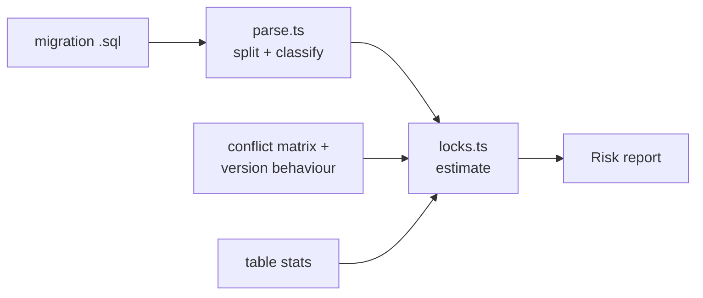

# Architecture

## Context

Schema migrations are reviewed as SQL, but their cost depends on the lock they take, the server version, and the size and traffic of the table. locksmith turns a migration file into a per-statement risk report so the blocking time is visible in review rather than in production.

## Components

- `parse.ts` strips comments, splits on `;`, drops `BEGIN`/`COMMIT`/`ROLLBACK`, classifies each statement into an `Operation`, and extracts the table name.
- `locks.ts` holds the lock-mode conflict matrix, the per-version behaviour of each `Operation`, the estimator, and the rewrite suggestions.

## Key decisions

- **Lock behaviour is data, keyed by version.** Only changes are recorded (PG 10, 11, 12); other versions inherit the nearest lower entry. The alternative, per-version branches in code, hides which behaviours actually changed.
- **Unknown means worst case.** An unrecognised statement is assumed to rewrite the table under `ACCESS EXCLUSIVE`. False alarms are cheaper than a missed outage.
- **Regex classifier with explicit ordering.** A grammar-based parser would be more robust; the regex approach keeps rules small and testable, at the cost of edge cases (see Limitations).
- **Transactions sum, not max.** A migration wrapped in `BEGIN`/`COMMIT` holds each lock until commit, so `inTransaction` is recorded on each statement.

## Failure modes

- Misclassified statement: falls to `UNKNOWN` (worst case) or, for an unusual form of a known statement, may be classified as a milder operation.
- Wrong throughput assumption: durations are scaled estimates, not guarantees.
- Semicolons inside string literals or function bodies split a statement incorrectly.

## Out of scope

Applying migrations, connecting to a database, and verifying behaviour against live servers.
